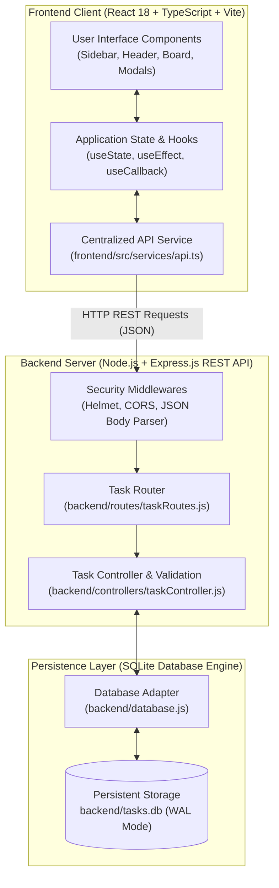

# TaskFlow — Task Management Kanban Board

> **A Full-Stack College Mini Project in Computer Science & Engineering**  
> Built with **React 18**, **TypeScript**, **Vite**, **Node.js**, **Express.js**, and a persistent **SQLite** database.

[](.github/workflows/ci.yml)
[](https://nodejs.org/)
[](https://www.typescriptlang.org/)
[](https://www.sqlite.org/)
[](LICENSE)

---

## 1. Project Overview

**TaskFlow** is an enterprise-grade productivity web application designed to help individuals and teams organize, track, and visualize tasks across progressive stages of completion. Featuring an intuitive three-column Kanban board (**To Do**, **In Progress**, and **Done**), the application implements real-time task movement via native HTML5 drag-and-drop as well as WCAG-compliant dropdown controls.

Unlike simple in-memory prototypes, **TaskFlow** is backed by an asynchronous RESTful Express API and a persistent, disk-backed SQLite database operating in Write-Ahead Logging (WAL) mode. Every task transition, creation, edit, and deletion is validated and immediately persisted.

---

## 2. Problem Statement

Modern software engineering and project management rely heavily on visual task boards to manage cognitive load and streamline sprint cycles. However, entry-level task managers often suffer from:
1. **Volatile Storage**: Tasks stored only in browser `localStorage` or server RAM are wiped on browser cache resets or server reboots.
2. **Poor Accessibility**: Many Kanban boards solely rely on mouse-driven drag-and-drop, excluding keyboard navigation and screen-reader users.
3. **Lack of Server Validation**: Inadequate validation allows corrupt dates, blank titles, and injection payloads.
4. **Decoupled Analytics**: Hardcoded or approximate dashboard statistics instead of dynamic relational aggregates.

**TaskFlow** resolves these challenges by providing a secure, accessible, type-safe full-stack system with true database persistence and live statistical reporting.

---

## 3. Project Objectives

- Implement an interactive three-column Kanban board with smooth drag-and-drop capabilities.
- Enforce strict server-side and client-side validation to guarantee data integrity.
- Store all records in a disk-persisted SQLite database (`tasks.db`) with relational constraints and indexing.
- Compute real-time dashboard analytics (Total tasks, Completed, In Progress, Pending, Completion Rate %, and Priority distribution).
- Ensure high accessibility standards with alternative dropdown move controls, accessible modals, and contrast ratios.
- Provide a clean, modular, and maintainable codebase ready for computer science academic evaluation and viva defense.

---

## 4. Key Features

- **Interactive Kanban Board**: Three visual columns with color-coded status badges and dynamic task counters.
- **Drag-and-Drop & Accessible Fallback**: Move cards seamlessly across columns using mouse drag-and-drop or an accessible inline move dropdown.
- **Full Task Lifecycle (CRUD)**:
  - **Create**: Modal dialog with title (required, max 200 chars), description, priority (Low/Medium/High), due date, and initial column.
  - **Read**: Dynamic query filtering by title/description search, status, and priority.
  - **Update**: Edit all task attributes with instant board refresh.
  - **Delete**: Confirmation dialog warning before permanent deletion from SQLite.
- **Dynamic Search & Filtering**: Instant client-server search and filter clearing with live result counters.
- **Multi-Criteria Sorting**: Sort by Due Date (Earliest/Latest), Priority (High-to-Low / Low-to-High), or Creation Time (Newest/Oldest).
- **Overdue Date Detection**: Automatically highlights overdue tasks in red with warning badges.
- **Real-Time Dashboard Analytics**: Dynamic cards showing total workload, completion percentage bar, and priority distributions.
- **Academic Viva Guide**: Built-in interactive tab displaying system architecture, database schema, REST API specs, and viva defense Q&A.
- **Demo Data Seeding**: One-click "Reset Demo Tasks" button to populate realistic project tasks for demonstrations.

---

## 5. Technology Stack

### Frontend
- **Framework**: [React 18](https://react.dev/)
- **Language**: [TypeScript 5.6](https://www.typescriptlang.org/)
- **Build Tool**: [Vite 6](https://vitejs.dev/)
- **Icons**: [Lucide React](https://lucide.dev/)
- **Styling**: Vanilla CSS3 Design System with CSS variables and responsive media queries

### Backend
- **Runtime**: [Node.js](https://nodejs.org/) (Compatible with v22.5+ native SQLite and v20+ with fallback)
- **Framework**: [Express.js 4](https://expressjs.com/)
- **Security**: [Helmet](https://helmetjs.github.io/) (HTTP security headers) & [CORS](https://expressjs.com/en/resources/middleware/cors.html)
- **Logging**: [Morgan](https://github.com/expressjs/morgan)
- **Testing**: Built-in `node:test` runner and [Supertest](https://github.com/ladjs/supertest)

### Database
- **Engine**: [SQLite 3](https://sqlite.org/) with Write-Ahead Logging (`PRAGMA journal_mode = WAL`)
- **Persistence**: File-based storage (`backend/tasks.db`)
- **Query Safety**: 100% Parameterized prepared statements preventing SQL injection

---

## 6. Architecture Overview



---

## 7. Folder Structure

```
task-management-kanban-board/
├── .github/
│   └── workflows/
│       └── ci.yml               # GitHub Actions CI workflow (Build & Test)
├── backend/
│   ├── controllers/
│   │   └── taskController.js    # Business logic, input validation, DB queries
│   ├── routes/
│   │   └── taskRoutes.js        # Express route definitions
│   ├── tests/
│   │   └── api.test.js          # Automated REST API integration test suite
│   ├── database.js              # SQLite connection, schema initialization & WAL
│   ├── package.json             # Backend dependencies and scripts
│   ├── server.js                # Express server entry point & error handlers
│   └── tasks.db                 # Persistent SQLite database file
├── frontend/
│   ├── public/                  # Static assets
│   ├── src/
│   │   ├── components/
│   │   │   ├── ConfirmDeleteModal.tsx # Accessible delete confirmation
│   │   │   ├── FilterBar.tsx          # Search, status/priority filters, sort
│   │   │   ├── Header.tsx             # Top navbar & actions
│   │   │   ├── KanbanBoard.tsx        # 3-column Kanban container
│   │   │   ├── KanbanColumn.tsx       # Individual column & drop zone
│   │   │   ├── Sidebar.tsx            # Left navigation & connectivity badge
│   │   │   ├── StatsDashboard.tsx     # Dynamic metrics & progress bar
│   │   │   ├── TaskCard.tsx           # Draggable card with move dropdown
│   │   │   ├── TaskModal.tsx          # Create/Edit task modal
│   │   │   ├── Toast.tsx              # Toast notification container
│   │   │   └── VivaInfoModal.tsx      # Viva defense guide & tech specs
│   │   ├── services/
│   │   │   └── api.ts                 # Centralized HTTP client
│   │   ├── types.ts                   # TypeScript interfaces & types
│   │   ├── App.tsx                    # Main state management & layout
│   │   ├── App.css                    # Component styling & design tokens
│   │   ├── index.css                  # Global typography & CSS reset
│   │   ├── main.tsx                   # React root entry point
│   │   └── vite-env.d.ts              # Vite TypeScript ambient declarations
│   ├── index.html                     # HTML document shell
│   ├── package.json                   # Frontend dependencies and scripts
│   ├── tsconfig.json                  # TypeScript compiler settings
│   ├── tsconfig.node.json             # TypeScript Vite config settings
│   └── vite.config.ts                 # Vite bundler & reverse proxy setup
├── .gitignore                         # Git ignore patterns
├── LICENSE                            # MIT License
└── README.md                          # Comprehensive project documentation
```

---

## 8. Database Design

The system uses a single normalized table named `tasks` with strict check constraints and performance indexes:

### Schema Definition

```sql
CREATE TABLE IF NOT EXISTS tasks (
  id INTEGER PRIMARY KEY AUTOINCREMENT,
  title TEXT NOT NULL,
  description TEXT DEFAULT '',
  status TEXT NOT NULL CHECK(status IN ('todo', 'in_progress', 'done')),
  priority TEXT NOT NULL CHECK(priority IN ('low', 'medium', 'high')),
  due_date TEXT DEFAULT NULL,
  created_at TEXT NOT NULL DEFAULT (datetime('now')),
  updated_at TEXT NOT NULL DEFAULT (datetime('now'))
);

CREATE INDEX IF NOT EXISTS idx_tasks_status ON tasks(status);
CREATE INDEX IF NOT EXISTS idx_tasks_priority ON tasks(priority);
CREATE INDEX IF NOT EXISTS idx_tasks_due_date ON tasks(due_date);
```

### Data Dictionary

| Column Name | Data Type | Constraints | Default | Description |
| :--- | :--- | :--- | :--- | :--- |
| `id` | `INTEGER` | `PRIMARY KEY AUTOINCREMENT` | Auto | Unique surrogate primary key. |
| `title` | `TEXT` | `NOT NULL`, max 200 chars | None | Task summary or title. |
| `description` | `TEXT` | Optional, max 2000 chars | `''` | Detailed notes, requirements, or steps. |
| `status` | `TEXT` | `CHECK(status IN ('todo', 'in_progress', 'done'))` | `'todo'` | Workflow column position. |
| `priority` | `TEXT` | `CHECK(priority IN ('low', 'medium', 'high'))` | `'medium'` | Task urgency and priority level. |
| `due_date` | `TEXT` | `NULL` or format `YYYY-MM-DD` | `NULL` | Task completion deadline. |
| `created_at` | `TEXT` | ISO 8601 UTC timestamp | `datetime('now')` | Creation record timestamp. |
| `updated_at` | `TEXT` | ISO 8601 UTC timestamp | `datetime('now')` | Modification record timestamp. |

---

## 9. REST API Specifications

All endpoints return uniform JSON envelopes. Errors return `{ "success": false, "error": "Message" }`.

| Method | Endpoint | Description | Request Body / Query Params | Status Codes |
| :--- | :--- | :--- | :--- | :--- |
| `GET` | `/health` | Server and database health check | None | `200` |
| `GET` | `/api/tasks` | Fetch tasks with optional filters | `?search=...&status=...&priority=...&sort=...` | `200` |
| `GET` | `/api/tasks/stats` | Aggregated dashboard statistics | None | `200` |
| `GET` | `/api/tasks/:id` | Retrieve single task by ID | None | `200`, `400`, `404` |
| `POST` | `/api/tasks` | Create a new task | `{ "title": "...", "description": "...", "priority": "...", "due_date": "...", "status": "..." }` | `201`, `400` |
| `PUT` | `/api/tasks/:id` | Full update of task attributes | `{ "title": "...", "description": "...", "priority": "...", "due_date": "..." }` | `200`, `400`, `404` |
| `PATCH` | `/api/tasks/:id/status` | Fast update of status (Drag/Drop) | `{ "status": "todo" \| "in_progress" \| "done" }` | `200`, `400`, `404` |
| `DELETE`| `/api/tasks/:id` | Delete task permanently from DB | None | `200`, `400`, `404` |
| `POST` | `/api/tasks/reset` | Reset DB to default sample tasks | None | `200` |

---

## 10. Installation & Setup Instructions

### Prerequisites
- **Node.js**: v22.5.0 or higher recommended (or v20.x+)
- **npm**: v10.x or higher
- **Git**: Installed and configured

### Step 1: Clone or Navigate to Project
```bash
git clone <repository_url>
cd task-management-kanban-board
```

### Step 2: Install Backend Dependencies
```bash
cd backend
npm install
```

### Step 3: Install Frontend Dependencies
```bash
cd ../frontend
npm install
```

---

## 11. Running the Application

To run the application locally, start the backend and frontend in two separate terminals:

### Terminal 1: Start Backend Server
```bash
cd backend
npm start
```
*Output:*
```
Kanban Board API Server running on port 5000
Health check: http://localhost:5000/health
API Base: http://localhost:5000/api/tasks
```

*(Optional: Use `npm run dev` in backend to enable hot-reloading with `node --watch`)*

### Terminal 2: Start Frontend Development Server
```bash
cd frontend
npm run dev
```
*Output:*
```
  VITE v6.x.x  ready in 200 ms

  ➜  Local:   http://localhost:5173/
  ➜  Network: use --host to expose
```

Open **`http://localhost:5173`** in your browser to interact with the application.

---

## 12. Automated Testing & Quality Assurance

The project features comprehensive automated test coverage for both backend REST APIs and frontend React components (totaling **49 automated tests**).

### Backend REST API Tests
Implemented using Node.js built-in test runner (`node:test`) and `supertest` for fast, zero-dependency integration testing.

```bash
cd backend
npm test
```
*Test Results: **25 passed**, 0 failed (runs in < 700ms)*
- Server Health & Metadata (`/health`, `/`)
- Task Retrieval & Seed Validation (`GET /api/tasks`)
- Real-Time Aggregated Statistics (`GET /api/tasks/stats`)
- Task Creation with Boundary Checks (`POST /api/tasks`)
- Input Validation: Rejection of blank titles, titles > 200 chars, invalid statuses, invalid priorities, and malformed dates
- Primary Key Retrieval & 404 Handlers (`GET /api/tasks/:id`)
- Full Updates & Missing ID Handlers (`PUT /api/tasks/:id`)
- Drag-and-Drop Status Patch (`PATCH /api/tasks/:id/status`)
- Query Filters: Title/description search, status filter, and priority filter
- Database Sorting: Due date and priority ordering
- Permanent Deletion & 404 Verification (`DELETE /api/tasks/:id`)
- Sample Data Reset Endpoint (`POST /api/tasks/reset`)

### Frontend Component Tests
Implemented using `Vitest`, `@testing-library/react`, and `@testing-library/jest-dom` in a simulated JSDOM environment.

```bash
cd frontend
npm test
```
*Test Results: **24 passed**, 0 failed (runs across 4 test suites)*
- **Dashboard (`StatsDashboard.test.tsx`)**: Validates metric card rendering (Total, Completed, In Progress, Pending), completion progress bar calculation, priority pill breakdown, and skeleton loading state.
- **Task Modal (`TaskModal.test.tsx`)**: Validates input rendering, client-side validation error banners, title length constraints, valid data dispatch to `onSubmit`, edit mode pre-population, and modal dismissal.
- **Task Cards (`TaskCard.test.tsx`)**: Validates card display, overdue badge computation for past deadlines, edit/delete button callbacks, inline move selector dropdown, and draggable HTML5 attributes.
- **Filter Bar (`FilterBar.test.tsx`)**: Validates search input debouncing, dropdown filter changes (priority, status, sort), dynamic task count indicators, and "Clear Filters" button reactivity.

### Type Check & Production Build
```bash
cd frontend
npm run build
```
Executes `tsc` with strict type checking followed by Vite production bundling with zero errors.

---

## 13. Docker Containerization

Docker is suitable for this application because it encapsulates the complete Node runtime, persistent SQLite storage, and compiled React single-page application into a single lightweight, production-ready container.

### Architecture in Docker
A **multi-stage build** (`Dockerfile`) is used:
1. **Stage 1 (`frontend-builder`)**: Uses `node:22-alpine` to install frontend dependencies (`npm ci`) and build optimized static assets (`dist/`).
2. **Stage 2 (`runner`)**: Uses `node:22-alpine` to install production backend dependencies (`npm ci --omit=dev`), copies backend controllers/routes, copies built static assets from Stage 1, creates a persistent `/app/data` directory for SQLite, and serves the entire full-stack application on port `5000`.

### Running with Docker Compose (Recommended)

To build and start the container with persistent storage:
```bash
docker compose up --build -d
```
The application will be accessible at **`http://localhost:5000`**.

To stop the container:
```bash
docker compose down
```

### Building and Running the Docker Image Directly

1. **Build the Docker Image**:
   ```bash
   docker build -t task-management-kanban .
   ```

2. **Run Container with a Persistent SQLite Volume**:
   ```bash
   docker run -d \
     --name kanban-app \
     -p 5000:5000 \
     -v kanban_data:/app/data \
     -e PORT=5000 \
     -e NODE_ENV=production \
     -e DB_PATH=/app/data/tasks.db \
     task-management-kanban
   ```

3. **Check Container Health**:
   ```bash
   docker ps
   # Inspect health status (monitored via /health endpoint)
   ```

---

## 14. GitHub Actions CI/CD Pipeline

The repository includes a modern GitHub Actions workflow configured at [`.github/workflows/ci.yml`](.github/workflows/ci.yml) that automatically runs on every push and pull request to `main` or `master`.

### Workflow Pipeline Jobs
1. **`backend-test`**:
   - Checks out repository code.
   - Sets up Node.js 22.x with npm dependency caching.
   - Installs dependencies cleanly using `npm ci`.
   - Executes the 25-assertion backend API test suite (`npm test`).
2. **`frontend-test-and-build`**:
   - Sets up Node.js 22.x with npm dependency caching.
   - Installs dependencies cleanly using `npm ci`.
   - Executes the 24-assertion Vitest component test suite (`npm test`).
   - Runs TypeScript strict type check and produces production bundle (`npm run build`).
3. **`docker-build-and-push`**:
   - Runs only after both backend and frontend jobs pass.
   - Sets up Docker Buildx.
   - Authenticates with **GitHub Container Registry (GHCR)** using standard repository permissions (`packages: write`) and the built-in `${{ secrets.GITHUB_TOKEN }}` (no external or hardcoded secrets required).
   - Builds the multi-stage image.
   - Pushes the tagged container image (`ghcr.io/<owner>/<repo>:latest`) on branch push, or verifies the build without pushing on pull requests.

---

## 15. College Viva / Presentation Preparation

During your project viva or evaluation, examiners frequently ask the following questions. Practice these concise responses:

1. **Q: What architecture pattern does this project follow?**  
   *A:* A decoupled 3-tier client-server architecture: Client (React SPA), Server (Node.js/Express REST API), and Persistence (SQLite Relational Database). Communication takes place over HTTP using JSON payloads.

2. **Q: Why choose SQLite over Browser `localStorage`?**  
   *A:* `localStorage` is tied strictly to a single client browser, holds no schema enforcement, has a 5MB storage ceiling, and cannot support multi-client synchronization. SQLite provides ACID-compliant transactions, indexing, relational constraints, and server-side persistence.

3. **Q: How are SQL Injection vulnerabilities prevented?**  
   *A:* All queries use parameterized statements (`?` placeholders). User input is treated strictly as literal data rather than executable SQL commands.

4. **Q: How does Drag-and-Drop work across columns?**  
   *A:* Using the native HTML5 Drag and Drop API: `onDragStart` encodes the task ID into `event.dataTransfer`. When dropped onto a `KanbanColumn`, `onDrop` decodes the ID and invokes an asynchronous `PATCH /api/tasks/:id/status` call to the server.

5. **Q: How are keyboard and mobile users accommodated if they cannot drag cards?**  
   *A:* Each card features an accessible inline status `<select>` dropdown, allowing keyboard and touch users to change a task's stage without dragging.

6. **Q: How are the dashboard analytics calculated?**  
   *A:* Server-side in real time using SQL aggregate functions (`COUNT(*)`, `WHERE status = ...`, `WHERE due_date < date('now')`). They are dynamic database metrics, not hardcoded frontend estimates.

7. **Q: How does your CI pipeline ensure code quality?**  
   *A:* Through automated GitHub Actions running on Node 22: it validates backend endpoints with Supertest, validates frontend components with Vitest in JSDOM, verifies TypeScript types, builds the production bundle, and builds the Docker container.

---

## 16. Troubleshooting

- **Backend fails to start (`EADDRINUSE: 5000`)**:  
  Another process is utilizing port 5000. Stop that process or start the backend with a custom port:  
  `PORT=5001 npm start` (and update `VITE_API_BASE_URL=http://localhost:5001` or Vite proxy).
- **Frontend shows "API Disconnected"**:  
  Ensure the Express server in `backend/` is running on port 5000. Check `http://localhost:5000/health` in your browser.
- **Database reset**:  
  To reset sample demonstration data at any time, click the **"Reset Demo Tasks"** button in the sidebar or run `curl -X POST http://localhost:5000/api/tasks/reset`.

---

## 17. License

This project is licensed under the [MIT License](LICENSE).

